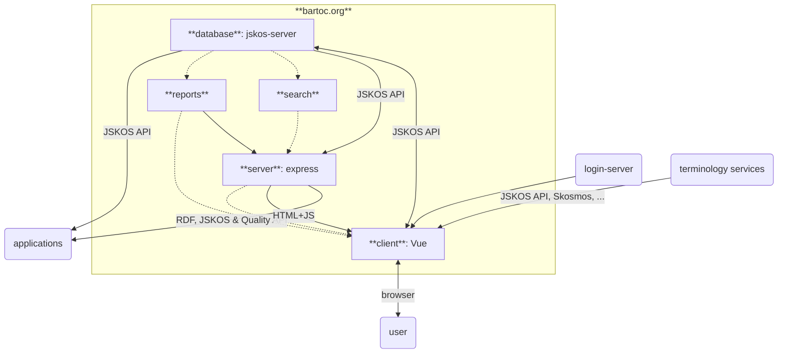

# BARTOC.org


[](https://github.com/gbv/bartoc.org/blob/master/LICENSE)
[](https://github.com/gbv/bartoc.org/blob/master/docker/README.md)
[](https://github.com/gbv/bartoc.org/actions/workflows/test.yml)

> Basic Register of Thesauri, Ontologies & Classifications (BARTOC)

This repository contains the [web interface of BARTOC.org](https://bartoc.org), run by [VZG](https://www.gbv.de/).

The application is currently being reconstructed funded by DFG.

## Table of Contents

- [Install](#install)
- [Configuration](#configuration)
- [Data flow](#data-flow)
- [Scripts](#scripts)
- [Quality API](#quality-api)
- [Development](#development)

## Install

### Requirements

Requires Node.js 22.19 or newer and an instance of [jskos-server](https://github.com/gbv/jskos-server) to connect to. Additional dependencies are listed in `package.json`.

### Install from sources

~~~sh
git clone https://github.com/gbv/bartoc.org.git
cd bartoc.org
npm ci
~~~

### Docker

You can also set up BARTOC via Docker. Please refer to our [Docker docs](./docker/README.md).

### Setup
Clone the auxiliary vocabulary sources beside this repository. The setup script needs both their path and the path to your jskos-server installation:

```bash
git clone https://github.com/gbv/bartoc-vocabularies.git ../bartoc-vocabularies
./bin/setup.sh ../jskos-server ../bartoc-vocabularies
```

#### Updating auxiliary vocabularies

Changes in `bartoc-vocabularies` are not imported automatically.

For a local installation, pull the changes and run the import:

```bash
git -C ../bartoc-vocabularies pull --ff-only
./bin/import-vocabularies.sh ../jskos-server ../bartoc-vocabularies
```

This updates the six auxiliary vocabularies without resetting other data.

The Docker image includes the current `bartoc-vocabularies/main` at build time.
After updating the image, import the files into its persistent database:

```bash
docker compose exec -it bartoc bash -lc \
  'cd /usr/src/app/bartoc && ./bin/import-vocabularies.sh ../jskos-server ../bartoc-vocabularies'
```

- **dev.bartoc.org:** rebuild and deploy the `dev` image, then run the import
  command in the development container.
- **bartoc.org:** build and deploy a release image, then run the import command
  in the production container.

The Docker workflow only publishes images. It does not deploy them or import
the vocabularies.

> **Work in progress:** this update process is still manual and should be
> automated. Until then, building the image, deploying it, and importing the
> vocabularies are separate required steps.

## Configuration

Basic configuration is located in `config/config.default.json`. Selected fields can be overridden in a local `config/config.json`. The latter should at least include a link to a JSKOS server instance, e.g.:

~~~json
{
  "backend": {
    "provider": "ConceptApi",
    "api": "http://localhost:3000/"
  }
}
~~~

To be able to log in, add, and edit vocabularies, you need to setup and configure an instance of [Login Server](https://github.com/gbv/login-server) as well (example for local installation):

```json
{
  "login": {
    "api": "localhost:3004/",
    "ssl": false
  }
}
```

### jskos-server

To be able to use the full functionality of BARTOC, your jskos-server installation must allow concept schemes to be written via the API, e.g.:

```json
{
  "schemes": {
    "read": {
      "auth": false
    },
    "create": {
      "auth": true
    },
    "update": {
      "auth": true,
      "crossUser": true
    }
  }
}
```

Via an array `identities` under `schemes`, you can limit which identity URIs can write vocabulary data.

### Knowledge Graph

BARTOC Knowledge Graph query page is enabled at `/graph/` when `sparql` is configured with an absolute SPARQL endpoint URL.

The page displays the latest update timestamp retrieved via SPARQL query `<https://bartoc.org/graph/terminology/> dct:modified ?updated` in the named graph `<https://bartoc.org/graph/terminology/>`.

A set of example queries can be provided with `sparqlExamples` as URL of a
[MatGUI Web workspace](https://github.com/Matdata-eu/MatGUI/blob/main/docs/user-guide.md#web-workspaces).
The default value points to a HTTP release of repository <https://github.com/gbv/bartoc-queries>:

```json
{
  "sparql": "https://bartoc.org/api/sparql",
  "sparqlExamples": "https://gbv.github.io/bartoc-queries/workspace.json"
}
```

## Data flow

Dotted elements are not implemented yet.



## Scripts

To regularly update dumps, add a cronjob with command `npm run dump`. Dumps are placed in `data/dumps` and reports in `data/reports`. To compare dump files, run `node bin/dump.js diff FILE1 [FILE2]`.

The dump command also creates quality reports as JSON and CSV files. `validation-errors.json` lists records with validation errors, and `summary.json` groups validation errors and quality warnings by record.

## Quality API

BARTOC exposes generated quality reports through an **experimental** read-only API at `/quality/`.

Reports are generated asynchronously by `npm run dump`. API requests read the files in `data/reports`; they do not validate records or regenerate reports.

- `/quality/` — human-readable API documentation
- `/quality/openapi.json` — OpenAPI 3.1 description
- `/data/reports/` — existing JSON and CSV downloads

For a local development instance, open <http://localhost:3883/quality/>.

## Development

~~~sh
npm run dev
~~~

The application is made available at <http://localhost:3883/>.
Express also serves Vite's development assets on this port.

### CSS approach

Shared design tokens and component-level CSS are provided by `@gbv/bartoc-components` (<https://github.com/gbv/bartoc-components>).
Application-specific layout rules live in `static/css/layout.css` and should consume the shared `--cc-*` tokens instead of redefining them.

### Publish

**For maintainers only**

Never work on the main branch directly. Always make changes on `dev` and then run the release script:

```bash
npm run release:patch # or minor or major
```

### Deployment

The application is deployed at <https://bartoc.org/>.

Update an existing installation:

~~~sh
git pull
npm install
npm run build
pm2 restart bartoc.org
~~~

Build the Vue assets before starting or restarting the production server. Docker builds them in the image. `NODE_ENV` must be set to `production` when starting the server; `npm run start` sets it automatically.

